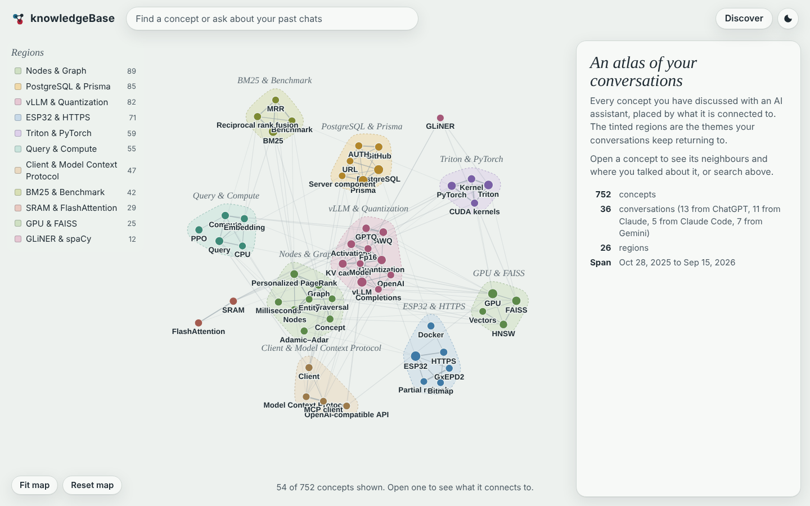
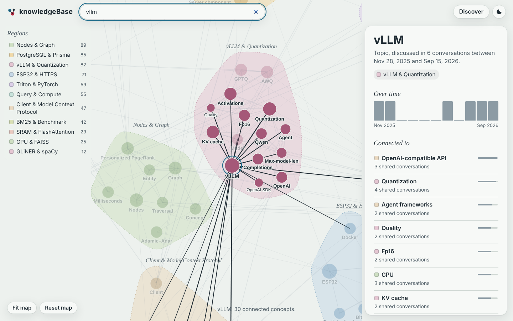
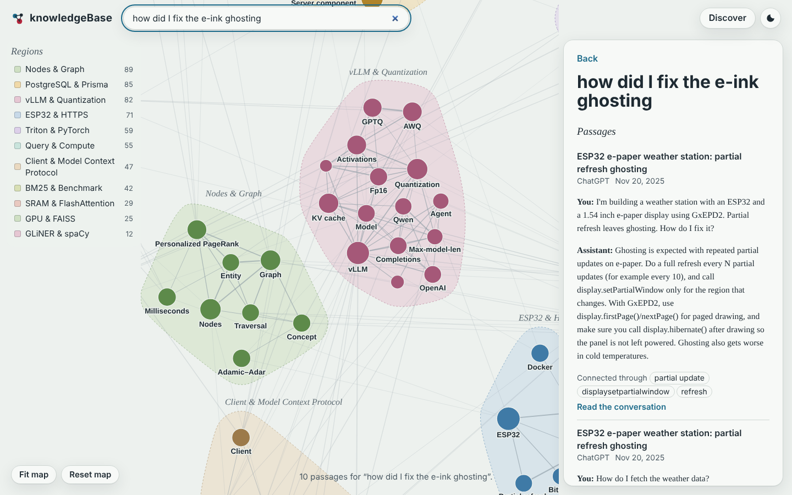
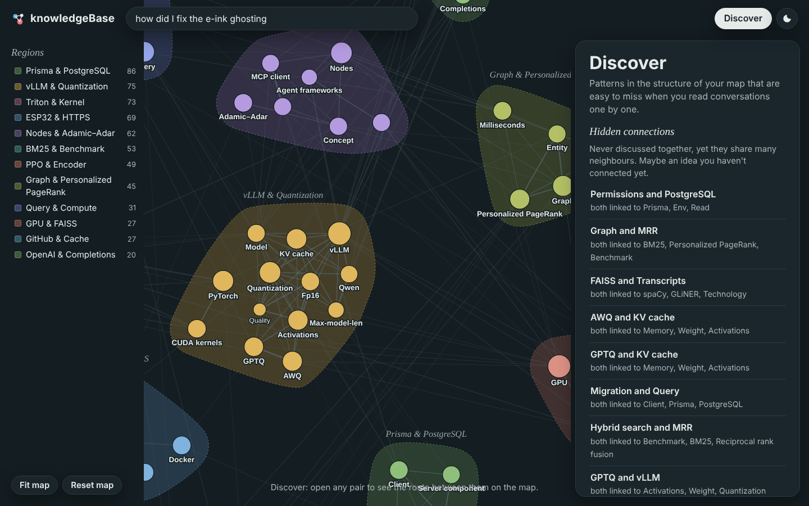

# 🧠 KnowledgeBase

> **A graph-first personal cognition system**
>
> Turn every conversation you've had with ChatGPT, Claude, Gemini and Claude Code into one connected
> knowledge graph that you can explore, search and plug into your AI agents.



---

## Why

Every day we think out loud with AI assistants — ChatGPT, Claude, Gemini, Claude Code, OpenCode.
Each conversation contains knowledge, but it is scattered across apps, and finding *where* something was
discussed is often harder than understanding it again.

KnowledgeBase treats your chat history as one body of knowledge instead of a pile of chat logs:

* **Connected** — concepts are linked across conversations and platforms, so you see how your ideas relate.
* **Searchable** — graph-aware search finds passages even when they share no words with your question.
* **Discoverable** — the graph points out bridges, unexpected links and ideas you never connected yourself.
* **Usable by your agents** — an MCP server gives Claude Code, Cursor or any MCP client access to your history.
* **Local-first** — everything runs on your machine; the vault is plain Obsidian markdown.

---

## Quick start

```bash
git clone https://github.com/5uryansh/knowledgeBase && cd knowledgeBase
pip install -e ".[ml]"                 # or ".[lite]" for a small, torch-free install (see below)
python -m spacy download en_core_web_sm

kb demo                                # builds the bundled sample chats and opens the atlas
#   → http://127.0.0.1:3001             (explorer)
#   → http://127.0.0.1:3001/api/mcp     (MCP endpoint)
```

With your own data:

```bash
# put your exports where kb looks by default (or pass --export / use kb.yaml)
#   data/chatgpt/conversations.json
#   data/claude/conversations.json
#   data/gemini/Takeout/My Activity/Gemini Apps/MyActivity.json
#   data/claude-code/projects/            (copy of ~/.claude/projects)
kb build                               # parse → vault → graph → index
kb serve                               # explorer + REST API + MCP on port 3001
kb search "how did I fix the e-ink ghosting"
```

| install | embeddings | entities | size | when |
|---|---|---|---|---|
| `.[ml]` | `BAAI/bge-small-en-v1.5` (sentence-transformers) | GLiNER (zero-shot NER) | torch + ~200 MB models | best quality (default) |
| `.[lite]` | WordLlama (static, weights ship in the wheel) | spaCy + technical-term patterns | ~20 MB | laptops, air-gapped, CI |

`kb build` picks the best backend available automatically (`--embedder`, `--entities` override it).
Re-running it is cheap: parsing is idempotent and concept extraction is cached per conversation.

---

## The atlas (graph explorer)

The browser never loads the whole graph. It opens with the ~50 most important concepts — PageRank blended
with how often you came back to a topic, discounted for generic words — grouped into **regions**
(communities). Clicking a concept loads only its neighbourhood.

| Concept view | Graph-aware search |
|---|---|
|  |  |

* **Gazetteer panel** — strongest related concepts, typed relations with the sentence they came from,
  a timeline, and every conversation that mentions the concept (open it in the built-in reader, where
  every wiki-link is clickable).
* **Search** — ask in plain language; results come with the concepts that connected them to your question.
* **Discover** — structural insights, each shown as a route on the map:
  * *hidden connections*: recurring concepts never discussed together that share many neighbours
    (Adamic–Adar link prediction) — candidates for an idea you haven't connected yet
  * *unexpected links*: strong associations (NPMI) between different regions
  * *bridges*: concepts that connect otherwise separate regions (betweenness)
  * *not visited lately*: important concepts you haven't touched in months



**Share it without a server:** `kb export site/` writes the atlas as a static site (pre-computed JSON shards,
still lazy-loaded) that you can host on GitHub Pages or any static host. Conversation text is only included
with `--include-conversations`. This repository's `pages.yml` workflow publishes the sample-data atlas on every
push to `main` (enable *Settings → Pages → Source: GitHub Actions* once).

---

## MCP server — give your agents your memory

`kb serve` exposes a [Model Context Protocol](https://modelcontextprotocol.io) endpoint (Streamable HTTP)
at **`http://127.0.0.1:3001/api/mcp`**.

| tool | what it does |
|---|---|
| `search_knowledge` | graph-aware search over your past conversations, with citations |
| `explore_concept` | everything known about a concept: neighbours, relations, conversations, timeline |
| `find_connection` | strongest path between two concepts, with evidence for each hop |
| `discover` | bridges, unexpected links, hidden connections, forgotten topics |
| `get_conversation` | read a conversation (or the turns around a passage) |
| `top_concepts` | the central concepts and themes of your graph |

```bash
# Claude Code
claude mcp add --transport http knowledgebase http://127.0.0.1:3001/api/mcp
```

```jsonc
// Cursor / Windsurf / any client that speaks Streamable HTTP
{ "mcpServers": { "knowledgebase": { "url": "http://127.0.0.1:3001/api/mcp" } } }

// Claude Desktop (stdio only) via the mcp-remote bridge
{ "mcpServers": { "knowledgebase": { "command": "npx", "args": ["mcp-remote", "http://127.0.0.1:3001/api/mcp"] } } }
```

All tools are read-only. The server binds to localhost and rejects browser requests from foreign origins
(DNS-rebinding protection); add `--allow-origin` if you need to call it from another web app.

---

## How it works

```
 ChatGPT · Claude · Gemini · Claude Code exports
                    │  parsers → one Conversation model
                    ▼
 ① propose concepts per conversation        GLiNER / spaCy entities + noun-phrase topics,
                                             POS + stop-list filtering, alias canonicalisation
 ② select a global vocabulary                a concept mentioned once in five conversations
                                             matters even if no single conversation says so
 ③ link every conversation                   [[node|surface]] wiki-links (n-gram dictionary,
                                             never inside code/URLs, idempotent)
                    │
        ┌───────────┴─────────────────────────────┐
        ▼                                         ▼
 Obsidian vault                            Knowledge graph
 conversations/<platform>/…md              co-occurrence: sentence > paragraph > conversation
 entities/*.md, topics/*.md                NPMI-weighted (hubs can't dominate)
 (your edits outside the generated         typed relations with evidence sentences
  block are preserved)                     PageRank · Louvain regions · betweenness · discoveries
                                                  │
                                                  ▼
                                   Index: chunks (prompt + answer pairs)
                                          BM25 · dense embeddings · concept ↔ chunk graph
                                                  │
                                                  ▼
                       Retrieval = BM25 + dense + Personalized PageRank, fused with RRF
                                                  │
                                ┌─────────────────┼─────────────────┐
                                ▼                 ▼                 ▼
                            kb search       atlas (REST API)     MCP tools
```

### Graph retrieval

The retrieval graph joins concepts and chunks:
`concept ─ concept` (NPMI strength), `concept ─ chunk` (IDF-weighted mentions) and `chunk ─ chunk`
(adjacent turns). A query activates seed concepts — the ones it names, plus those in the best BM25/dense
hits — and **Personalized PageRank** spreads that activation through the graph (the HippoRAG idea). A chunk
can therefore rank highly because it is *connected* to the question, not only because it shares words with
it. The graph ranking is fused with BM25, dense and a conversation-level prior (chunks inherit the score of
their whole conversation) using weighted reciprocal-rank fusion, and every result reports which concepts
connected it (`via`).

---

## Benchmarks

Retrieval is measured on **[LoCoMo](https://github.com/snap-research/locomo)** (ACL 2024), a benchmark of
very long multi-session chat histories with annotated evidence turns — exactly the "where did I discuss X"
problem. Each history is converted into a Claude export and run through the full pipeline. Parameters were
tuned on a dev split (2 histories) and reported once on the held-out **test split (8 histories, 1,304
questions)**.

| retrieval | Recall@5 | Recall@10 | Recall@20 | MRR | nDCG@10 | multi-hop R@10 |
|---|---|---|---|---|---|---|
| **graph + hybrid (default)** | **0.673** | **0.755** | **0.817** | **0.578** | **0.598** | **0.459** |
| BM25 + dense (hybrid) | 0.656 | 0.715 | 0.770 | 0.561 | 0.574 | 0.443 |
| BM25 | 0.638 | 0.718 | 0.762 | 0.568 | 0.579 | 0.435 |
| graph only (PPR) | 0.470 | 0.564 | 0.653 | 0.371 | 0.398 | 0.304 |
| dense only | 0.463 | 0.538 | 0.633 | 0.397 | 0.407 | 0.304 |
| previous retriever (v0.1) | 0.463 | 0.538 | 0.561 | 0.394 | 0.407 | 0.304 |

<sub>Embeddings: WordLlama (the `lite` backend), entities: spaCy — the benchmark environment could not
download transformer models. With `bge-small` dense retrieval is considerably stronger; re-run the benchmark
on your machine with `--embedder sentence-transformers`. The v0.1 retriever returned on average 334
unranked chunks per query; its top-10 equals plain dense search.</sub>

```bash
python -m benchmarks.run --split test                 # full LoCoMo evaluation (downloads the data)
python -m benchmarks.tune                             # re-tune fusion/graph parameters on the dev split
python -m benchmarks.sample                           # quick sanity check on the bundled sample chats
```

See [benchmarks/README.md](benchmarks/README.md) for metrics, methodology and how to benchmark your own history.

---

## Project layout

```
src/knowledgebase/
  parsers/        ChatGPT, Claude, Gemini (Takeout), Claude Code → Conversation
  enrichment/     concept extraction, vocabulary, linker, Obsidian vault writer
  graph/          co-occurrence (NPMI), relations, analytics & discoveries, specificity
  retrieval/      chunker, BM25, embedders, vector store, graph retriever (PPR), fusion, index
  server/         FastAPI app, MCP endpoint, static atlas UI
  pipeline.py     end-to-end build          cli.py   `kb` command
benchmarks/       LoCoMo converter, metrics, runner, tuner, legacy baseline, results/
examples/         sample chats in each platform's native export format + sample queries
tests/            pytest suite (parsers, linker, graph, retrieval, pipeline, REST + MCP)
```

### Configuration

Everything works without configuration. To customise, copy `kb.example.yaml` to `kb.yaml`
(`python main.py` still works too — it is the same as `kb build`):

```yaml
vault_dir: ~/Documents/KnowledgeBase     # open this folder in Obsidian
exports:
  claude: ~/Downloads/claude-export/conversations.json
embedder: auto                           # auto | sentence-transformers | wordllama | none
entity_extractor: auto                   # auto | gliner | spacy
aliases_file: my_aliases.yaml            # extra canonical names, e.g.  PyTorch: [torch, pt2]
port: 3001
```

Any setting can also be given as an environment variable (`KB_VAULT_DIR`, `KB_EMBEDDER`, …).

---

## Roadmap

- [x] Hybrid retrieval (BM25 + dense) with graph expansion via Personalized PageRank
- [x] Benchmark suite (Recall@K, MRR, nDCG, ablations, per-question-type breakdown)
- [x] Entity canonicalisation, NPMI hub suppression, communities, graph analytics
- [x] Temporal signals (first/last seen, timelines, forgotten topics)
- [x] MCP server and interactive graph explorer
- [ ] Cross-encoder reranking of the fused shortlist
- [ ] Incremental builds (only re-link conversations that changed)
- [ ] LLM-assisted relation extraction and concept summaries
- [ ] OpenCode / Cursor / terminal-session parsers
- [x] Static export of the atlas for sharing without a server

---

## Long-term goal

Not another chatbot: a persistent cognitive layer that grows with every conversation. Over time the graph
becomes a map of learning — not only *what* you know, but how concepts relate, evolve and influence one
another — and it is available to every AI tool you use.
